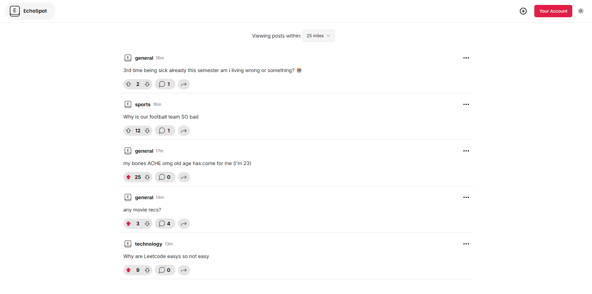
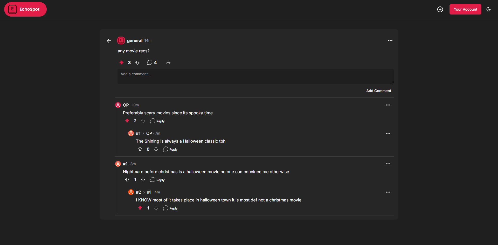
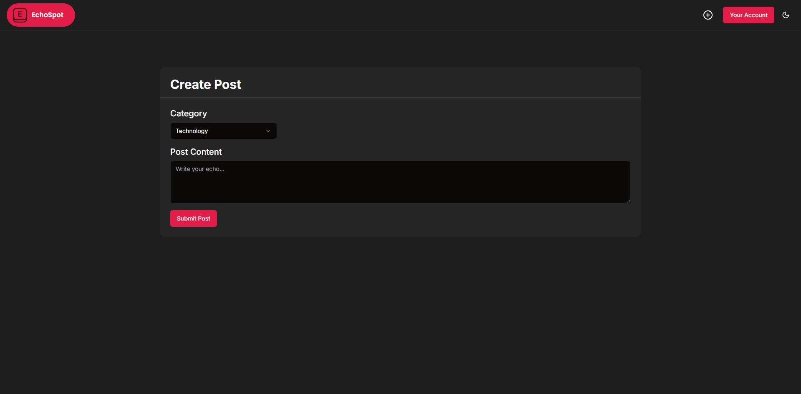
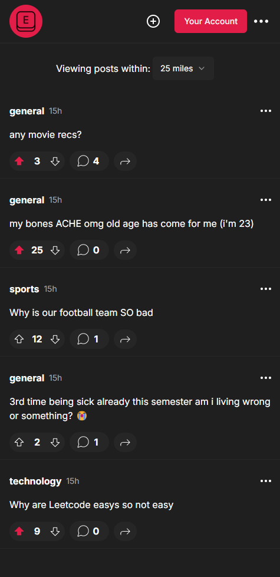

    
    <h3 align="center">Echo Spot</h3>

  

    A full-stack, anonymous social media app made for college students
     
    <a href="https://echo-spot.vercel.app"><strong>Project Website</strong></a>
  

## ℹ️ About Echo Spot

Echo Spot is a social media app aimed at college students that allows you to share your thoughts anonymously with those around you.

[![Echo Spot Main Screenshot][main-screenshot]](https://echo-spot.vercel.app)

## ✨ Features
- Create and share posts anonymously  
- Location-based feed tailored to your college  
- Comment and interact with other students  
- Dark/Light mode support  
- Fully responsive for mobile & desktop  

## 🛠️ Tech Stack

### Frontend
* ![Next.js][Next.js]
* ![React][React.js]
* ![TailWindCSS][TailWind]
* ![TypeScript][TypeScript]
* ![Clerk][Clerk]

### Backend
* ![MongoDB][MongoDB]
* ![Express.js][Express]
* ![Node.js][Node]

## ⭐ Why I Built This Project

As a college student, I noticed students often want to share thoughts, jokes, or advice without attaching their identity.  
I built Echo Spot to explore how anonymity can foster open discussions while still providing a fun, engaging social feed.  

## 📖 What I Learned

This project taught me:
- How to design and scale a **full-stack social media app**  
- Building secure **authentication flows** with Clerk  
- Using **MongoDB** to manage posts, comments, and users  
- Deploying a production-ready app with a responsive UI  

## 🎞️ Image Gallery

    <h3>Light View</h3>
    
    <h3>General Post</h3>
    
    <h3>Creating a Post</h3>
    
    <h3>Mobile View</h3>
    

## 📞 Contact

Will Graham - [LinkedIn](https://www.linkedin.com/in/will-graham-4623022a8/) - willgraham367@gmail.com  

Project Link: [https://github.com/WillGraham36/echo-spot](https://github.com/WillGraham36/echo-spot)

[Next.js]: https://img.shields.io/badge/next.js-000000?style=for-the-badge&logo=nextdotjs&logoColor=white
[React.js]: https://img.shields.io/badge/React-20232A?style=for-the-badge&logo=react&logoColor=61DAFB
[TailWind]: https://img.shields.io/badge/Tailwind_CSS-38B2AC?style=for-the-badge&logo=tailwind-css&logoColor=white
[TypeScript]: https://img.shields.io/badge/TypeScript-007ACC?style=for-the-badge&logo=typescript&logoColor=white
[Clerk]: https://img.shields.io/badge/Clerk-1b54bf?style=for-the-badge
[MongoDB]: https://img.shields.io/badge/MongoDB-4EA94B?style=for-the-badge&logo=mongodb&logoColor=white
[Express]: https://img.shields.io/badge/Express.js-404D59?style=for-the-badge
[Node]: https://img.shields.io/badge/Node.js-43853D?style=for-the-badge&logo=node.js&logoColor=white
[main-screenshot]: client/public/main-feed-dark.png
